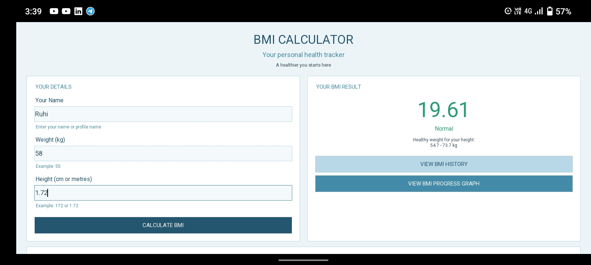
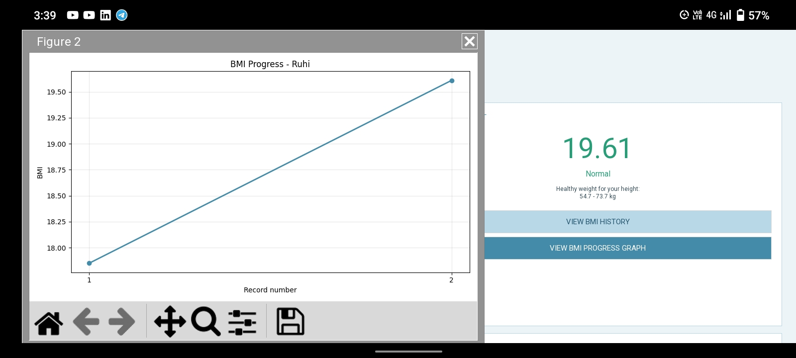
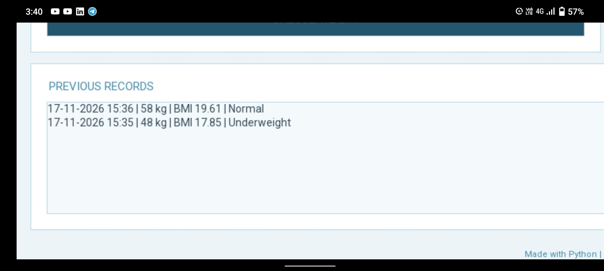

Advanced BMI Calculator

This is my Task 2 project for the Oasis Infobyte Python Programming Internship.

It is a desktop-style app made with Python and Tkinter. You enter your name, weight and height, and it shows your BMI, your category, and the weight range that would be healthy for your height. Every result is saved, so you can look at your old records and see how your BMI changes over time.

I built and tested it on my phone using the Pydroid 3 app, because I don't have a laptop right now.

## Screenshots

### Main screen

### BMI progress graph

### Previous records

What it can do

- Calculates BMI from weight (kg) and height
- Height can be typed in centimetres (172) or metres (1.72)
- Shows the category: Underweight, Normal, Overweight or Obese
- The result changes colour depending on the category
- Shows the healthy weight range for the height you entered
- Saves records for different users, so every name has its own history
- Shows the previous records for a name
- Draws a line graph of BMI over time (needs at least 2 records)
- Shows a message if something is wrong, like an empty name, letters instead of numbers, or a negative value
- Shows a message if the database cannot be read or saved

BMI categories used

BMI| Category
Below 18.5| Underweight
18.5 to 24.9| Normal
25 to 29.9| Overweight
30 and above| Obese

BMI = weight (kg) / (height in metres x height in metres)

Built with

- Python 3
- Tkinter (for the screen)
- SQLite3 (to save the records)
- Matplotlib (for the graph)

How to run it

1. Install Python 3.
2. Install Matplotlib: "pip install matplotlib"
3. Download "Aarya_Task2.py".
4. Run it: "python Aarya_Task2.py"
5. Type your name, weight and height, then press CALCULATE BMI.

Tkinter and SQLite come with Python. If you are on Linux and Tkinter is missing, install it with "sudo apt install python3-tk".

On Android: install Pydroid 3, install "matplotlib" from its Pip menu, open the file and press the play button.

The database file ("bmi_records.db") is created automatically the first time you run the app. To clear all saved records, just delete that file.

About your data

All records are saved only on your own device, in the "bmi_records.db" file. Nothing is sent online.

BMI is only a rough guide. It does not consider age or muscle, so please don't treat it as medical advice.

Problems I ran into

- The first version of my layout cut off some text on my phone screen. I changed it so the whole layout scales to fit the screen size.
- My graph looked wrong when two records were saved in the same minute. Now it uses record numbers (1, 2, 3...) on the bottom axis.

What I learned

- Learned to create a graphical interface using Python Tkinter.
- Understood how to store and retrieve user records using SQLite.
- Learned to create BMI progress graphs using Matplotlib.
- Improved my skills in input validation, error handling and designing a user-friendly application.

Possible improvements

- A button to delete old records
- Light and dark theme
- Adding age and gender for a more detailed health message

---

Made by Aarya Ramesh Khamkar for the Oasis Infobyte Python Programming Internship (Task 2).
