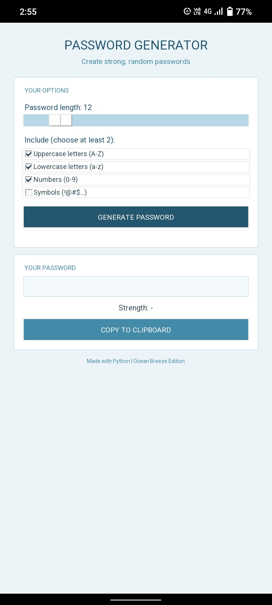
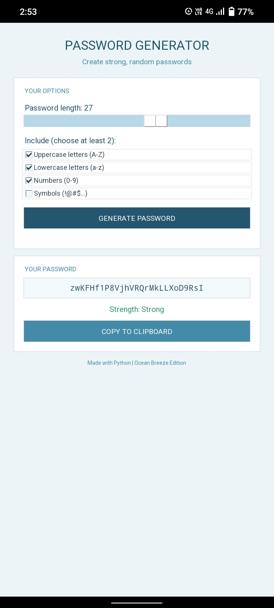
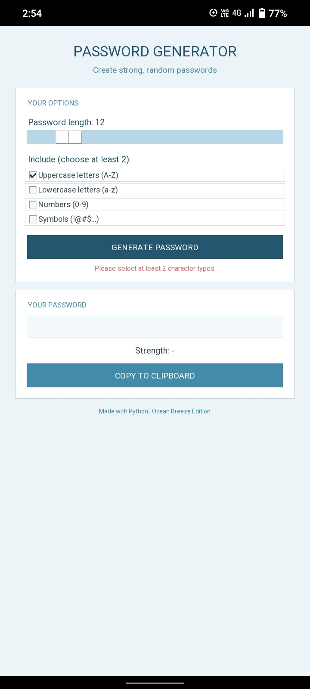

# Random Password Generator

This is Task 3 of my Oasis Infobyte Python Programming Internship.

It is a small app with a window where you can make strong, random passwords. You choose how long the password should be and what it should contain (capital letters, small letters, numbers, symbols). Then you press a button and the app makes the password for you. It also tells you if the password is weak, medium or strong, and there is a button to copy it.

I made and tested it on my phone using the Pydroid 3 app.

## Screenshots

**Main screen**

**A strong password**

**Error message when fewer than 2 character types are selected**

## What it can do

- A slider to choose the length, from 8 to 40 characters
- Checkboxes for capital letters, small letters, numbers and symbols
- You have to choose at least 2 types, otherwise it shows an error message
- Every type you choose is used at least once in the password
- Uses the `secrets` module (made for passwords) instead of `random`
- Shows if the password is Weak, Medium or Strong
- You can press Generate again to get a new password anytime
- A button to copy the password

## How the strength is decided

The strength depends on two things: how long the password is and how many types of characters it uses. Longer passwords with more types are stronger.

| Example | Strength |
|---------|----------|
| 8 characters, 2 types | Weak |
| 12 characters, 3 types | Medium |
| 12 characters, 4 types | Strong |
| 16 characters, 3 types | Strong |

## Built with

- Python 3
- Tkinter (for the window)
- `secrets` and `string` (both come with Python)

## How to run it

1. Install Python 3.
2. Download `Aarya_Task3.py`.
3. Run it with `python Aarya_Task3.py`

You don't need to install anything else. If you use Linux and Tkinter is missing, install it with `sudo apt install python3-tk`.

**On Android:** install Pydroid 3, open the file and press the play button.

## About your data

The passwords are made on your own device and only shown on the screen. I don't save them in any file and nothing goes online. When you close the app, the password is gone, unless you copied it somewhere.

## What I learned

- How to make a password in Python. The `string` module gives ready-made lists of letters, numbers and symbols, and `secrets.choice` picks a random character from them.
- Why `secrets` is better than `random` for passwords: it is made to be hard to guess.
- How to use lists, `if` conditions and loops together to build the password.
- How to make a window with a slider, checkboxes and buttons in Tkinter, and how to show error messages inside the window.
- One thing I want to remember: to make sure every chosen type shows up in the password, pick one character from each chosen type first, then fill the rest randomly and shuffle everything.

## Things I could add later

- An option to leave out look-alike characters like 0, O, l and 1
- A list of the last 5 passwords from the current session
- A bar that fills up to show the strength

---

Made by Aarya Ramesh Khamkar for the Oasis Infobyte Python Programming Internship (Task 3).
