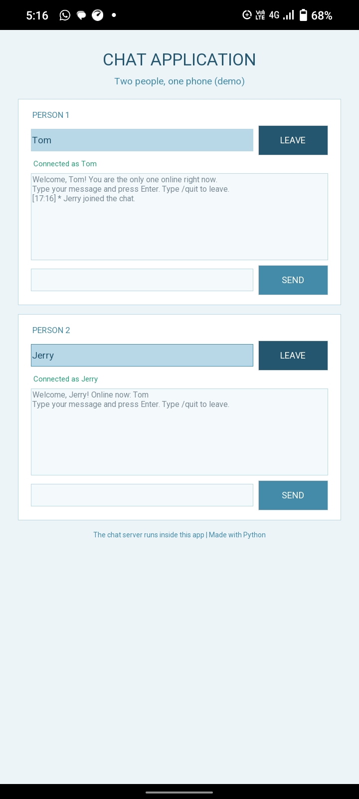
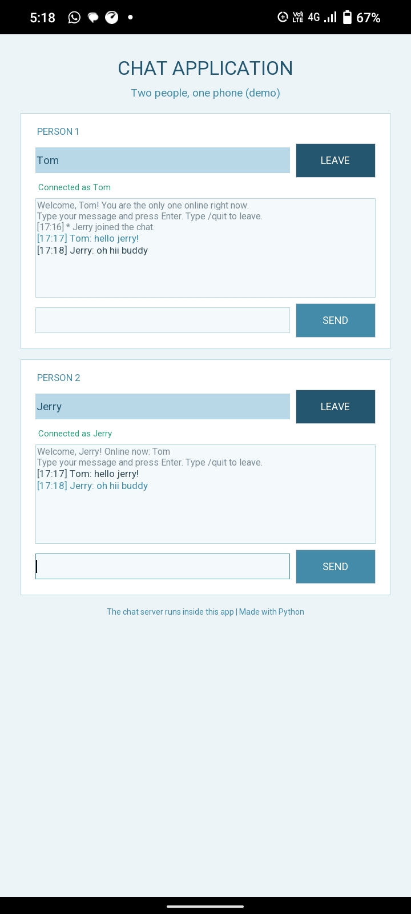
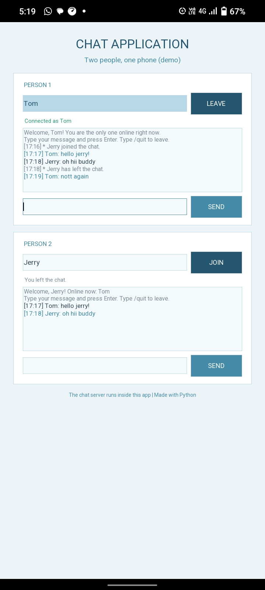

# Chat Application

This is my Task 5 for the Oasis Infobyte Python Programming Internship (beginner level).

It is a chat program made with Python sockets. There is one **server**, and everyone who wants to chat runs a **client** that connects to it. When one person sends a message, the others see it straight away with the time in front, like `[14:35] Alice: Hello`.

## My files

| File | What it does |
|------|--------------|
| `Aarya_Task5_server.py` | The chat server. Run this first. |
| `Aarya_Task5_client.py` | The chat client. Run it once for every person. |
| `Aarya_Task5_demo.py` | A demo for one device. It starts the server and shows two chat windows on one screen. |

## Why I made a demo file

I made this project on my phone using the Pydroid 3 app. Pydroid can run only one program at a time, so I could not start the server and a client together. To solve this, I made the demo file. It starts the server in the background and shows two chat windows on one screen. Each window connects to the server like a normal client.

The server and client files are the main project. On a laptop you can run them in two different terminals.

## Screenshots

**Both people joined**

**Chatting**

**One person leaves and the other one is told**

## What it can do

- The server waits for people to connect and handles each person in a separate thread
- The client sends and receives messages at the same time
- Messages go both ways, in real time
- Every message has the time in front of it
- When someone joins or leaves, the others are told
- When you join, you can see who is already online
- Two people cannot use the same name, and the name cannot be empty
- Very long messages are cut at 500 characters
- Type `/quit` to leave the chat
- If the server stops, the clients are told
- It works on `localhost`, so one device is enough

## How to run it

**Option 1: server and client (two terminals on a laptop)**

1. Install Python 3.
2. In the first terminal, run `python Aarya_Task5_server.py`. You will see "Chat server started!".
3. In a second terminal, run `python Aarya_Task5_client.py` and type your name.
4. In a third terminal, run the client again with a different name. Now two people can chat.

**Option 2: one device (like my phone)**

1. Save `Aarya_Task5_server.py` and `Aarya_Task5_demo.py` in the same folder.
2. Run `Aarya_Task5_demo.py`.
3. Press **JOIN** in both windows, then type a message and press **SEND**.

To chat between two different devices on the same Wi-Fi, change `HOST` in the server to `"0.0.0.0"`, and change `HOST` in the client to the IP address of the device that runs the server.

## About your messages

- The server only passes the messages on. It does **not save** them, so nothing is stored after the chat ends.
- The messages are **not encrypted**, so please don't send passwords or private information.
- There is no login. Anyone who can reach the server can join with a name that is not used.

## Built with

- Python 3
- `socket` and `threading` (they come with Python)
- Tkinter (only for the demo window)

## What I learned

- How a chat works with one server and many clients using sockets.
- What `localhost` and a port mean.
- Why the server needs a separate thread for every person, so that everyone can send messages at the same time.
- Why every message is sent as one line ending with a new line. Without it, two messages can get stuck together.
- How to show messages from another thread inside a Tkinter window.

## Things I want to add later

- A proper chat window for the real client (instead of the terminal)
- Login with username and password
- Chat rooms and saved message history

---

Made by Aarya Ramesh Khamkar for the Oasis Infobyte Python Programming Internship (Task 5).
